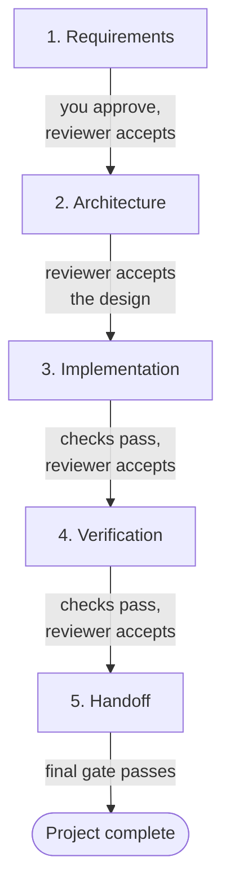
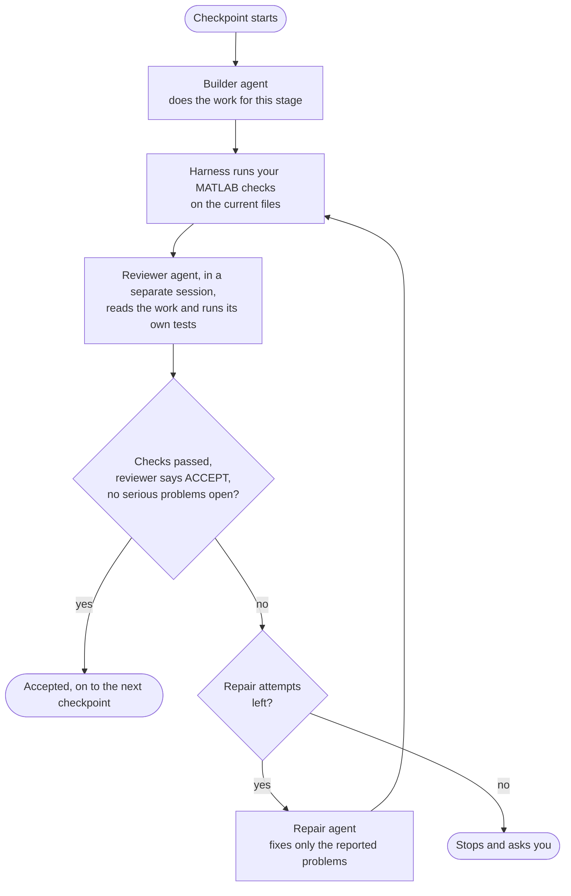

# MATLAB Engineering Harness

Make your AI coding agent do MATLAB and Simulink work the way an engineering team
would: agree on the requirements first, test everything in real MATLAB, and have a
second agent check the result before anything counts as done.

## Why use it

AI agents write MATLAB quickly, and they are rarely unsure of themselves. Ask one for
a cooling model and you get a script that runs, a plot that looks reasonable and a
confident summary. Whether the physics is right, the units are consistent or the
original requirement was met is something you still have to find out yourself.

The harness does that checking for you:

- **You agree on "done" up front.** Before any code is written, each requirement is
  written down with its units, where it came from and how it will be checked. Work
  starts only after you approve it.
- **Real MATLAB runs decide what passes.** A stage is accepted only after your
  MATLAB checks have run on the latest version of the files and passed. If a file
  changes afterwards, the old result no longer counts.
- **A second agent reviews the work.** The reviewer runs in a separate session from
  the builder. From implementation onward it must write its own tests rather than
  rerun the builder's, and it reports on every requirement.
- **Problems go back for repair, within limits.** When the reviewer or the checks
  find a problem, a repair agent gets exactly that list to fix. You decide how many
  repair attempts are allowed and how long the whole job may take.

Everything is saved in the project folder: requirements, approvals, test results and
reviews. You can stop at any point, and a new session, or a different agent, carries
on from where the last one stopped. The included MATLAB helpers also keep your setup
clean when your checks use them: Simulink caches and generated code go to temporary
folders, your MATLAB path and settings are restored, and models you have open with
unsaved changes are not touched.

It works with the agent you already use (Claude Code, Codex CLI, Antigravity CLI or
another) and your own MATLAB installation. It is plain Python with no extra
packages and no account. An optional MCP server lets your agent host drive a
project directly ([using the harness from your agent host](docs/hosts.md)).

### Is it right for you?

It is a good fit when the result has to be right and you need to show why: models,
simulations, calibrations, control code, and changes to existing Simulink models.

It adds steps on purpose. For a quick plot or a one-off script, asking your agent
directly is faster.

## How it works

The harness trusts what it can run, not what an agent says. A reviewer's own check
counts only when the harness ran it and kept a receipt. A review answer that cannot
be read stays open until it is replaced. Before verification and handoff, your tests
must catch the deliberate defects you name in a property plan. See
[evidence assurance](docs/evidence-assurance.md) for the details.

A project moves through five checkpoints. Each one has to be accepted before the
next one starts.



Inside every checkpoint, the same loop runs. The harness is the coordinator: it gives
each agent its task, runs MATLAB, and decides whether the checkpoint passes.



At the requirements checkpoint, the builder only drafts `requirements.md`; nothing
moves on until you approve it. MATLAB checks are optional for requirements and
architecture and required from implementation onward. At handoff, a document in your
project, such as a README or report, must list every requirement ID with its
evidence.

The harness also stops and asks you whenever it can't carry on by itself: when a
checkpoint has no MATLAB checks yet, when MATLAB can't run a check, or when the
reviewer rejects the work without saying what to fix. Repair attempts are counted
across the whole project (ten by default).

| Who | Role |
| --- | --- |
| You | Write and approve the requirements, supply the MATLAB checks, and answer when the harness asks. |
| Harness | Keeps the project record, hands out tasks, runs the checks and applies the gate. |
| Builder agent | Writes the design, the MATLAB code or Simulink model, and the verification. |
| Reviewer agent | Looks for what is wrong. It must be a different session from the builder. |
| Repair agent | Fixes the specific problems the reviewer or the checks found. |
| MATLAB | Runs the checks. Every result is saved with the files it tested. |

The agents never talk to each other directly. The harness writes each one a task file
and reads back what it produced, so every handover is saved in the project folder.

## What you need

- Python 3.10 or newer.
- Your own licensed MATLAB. Developed on Windows with MATLAB R2026a.
- Simulink, only if your project uses Simulink.
- An AI coding agent.

## Install

```powershell
git clone https://github.com/vallabh2504/Matlab-Simulink-harness.git
cd Matlab-Simulink-harness
python matlab_harness.py preflight --matlab "C:\Program Files\MATLAB\R2026a\bin\matlab.exe"
```

Use the path to your own MATLAB. If preflight prints `"status": "VERIFIED"`, the
harness can start MATLAB and you are ready.

You can also install it as a package from the
[latest release](https://github.com/vallabh2504/Matlab-Simulink-harness/releases/latest),
which gives you a `matlab-harness` command. The [installation guide](docs/install.md)
covers that, plus setting the MATLAB path once, updating and uninstalling.

## Quick start

This walks through one project by hand, so you can see each step. The commands use
PowerShell on Windows; on macOS or Linux, write paths with `/` (for example
`../cooling-study`). If you installed the package, type `matlab-harness` instead of
`python matlab_harness.py`.

1. **Create a project.** This makes a new folder with a project record and starter
   files. Existing files are never overwritten.

   ```powershell
   python matlab_harness.py start ..\cooling-study --title "Cooling study" --builder my-builder-session --owner me --scope src --brief "Predict lumped cooling of a part"
   ```

   `--owner` is your name for yourself in the record. `--builder` is any name for the
   agent session that does the work; the reviewer's session must have a different
   name. `--scope` is the folder the agents may change.

2. **Connect the skills to your agent.** This gives your agent the five MATLAB and
   Simulink skills that come with the harness.

   ```powershell
   python matlab_harness.py install-skills --target ..\cooling-study --runtime claude
   ```

   Use `--runtime codex` for Codex CLI.

3. **Write and approve the requirements.** Edit `requirements.md` in the project
   folder, then add each requirement and record your approval:

   ```powershell
   python matlab_harness.py --project ..\cooling-study requirement --owner me --id TH-1 --text "Temperature follows the lumped energy balance" --acceptance "Matches the analytic solution within 1e-6 K" --source "project brief" --units K
   python matlab_harness.py --project ..\cooling-study approve --owner me --actor me --source "approved in review meeting"
   ```

4. **Ask what comes next.** At any point, this tells you the current checkpoint and
   what is still missing:

   ```powershell
   python matlab_harness.py --project ..\cooling-study next
   ```

5. **Give the builder its task.** For the requirements checkpoint you have already
   written the requirements, so skip to step 7.

   ```powershell
   python matlab_harness.py --project ..\cooling-study packet --role builder
   ```

   This prints the path of a `prompt.md` file under `.matlab-harness\packets\`. Open
   your agent in the project folder and give it that file.

6. **Set up the tests (once, before implementation).** The requirements and
   architecture checkpoints have no tests, so skip this step until the architecture
   is accepted. Then, before the builder starts on implementation, do all of the
   following in this order. Changing any of it after a check has run makes that check
   and its review out of date (`Stale check`), and the probe runners and property plan
   cannot change at all once implementation is accepted.

   a. **Write the tests yourself**, outside the agents' folder. Create the `src`,
   `checks` and `reference` folders in the project. The check asserts what the
   requirement promises, with an assertion ID and a message. The reference is a
   known-good copy of the file under test; the harness uses it to confirm that your
   check catches a broken version. Use the file name your architecture names:

   ```matlab
   % checks\runCoolingCheck.m
   t = linspace(0, 600, 61);
   T = coolT(t, 90, 20, 120);
   expected = 20 + (90 - 20) * exp(-t / 120);
   assert(max(abs(T - expected)) < 1e-6, 'cooling:Decay', 'COOLING_DECAY');
   disp('cooling check passed')
   ```

   ```matlab
   % reference\coolT.m
   function T = coolT(t, T0, Tamb, tau)
   T = Tamb + (T0 - Tamb) * exp(-t / tau);
   end
   ```

   b. **Register the check.** Save a `checks.json` in the project folder that names
   each check and the command that runs it, then register it for each of the three
   tested checkpoints:

   ```json
   {"cooling-check": ["matlab", "-batch", "addpath('src'); addpath('checks'); runCoolingCheck"]}
   ```

   ```powershell
   python matlab_harness.py --project ..\cooling-study configure-checks implementation --owner me --plan checks.json
   python matlab_harness.py --project ..\cooling-study configure-checks verification --owner me --plan checks.json
   python matlab_harness.py --project ..\cooling-study configure-checks handoff --owner me --plan checks.json
   ```

   Use the full path to `matlab.exe` if `matlab` is not on your PATH.

   c. **Approve the program that runs the reviewer's own checks.** Save a
   `runners.json` such as `[{"kind": "matlab", "executable": "matlab"}]` (again, the
   full path if needed):

   ```powershell
   python matlab_harness.py --project ..\cooling-study configure-probes --owner me --plan runners.json --reason "Approved independent MATLAB probes"
   ```

   d. **Approve the property plan.** Each entry names a requirement, the check, the
   file under test, its reference and one or more deliberate defects. Each defect
   replaces one piece of text in the reference, and the check must then fail with the
   named assertion ID and message. Save it as `semantic-plan.json`:

   ```json
   {"stages": ["verification", "handoff"], "obligations": [
     {"id": "DECAY", "requirement": "TH-1", "check": "cooling-check",
      "target": "src/coolT.m", "reference": "reference/coolT.m",
      "failure_kind": "matlab-assertion", "assertion_id": "cooling:Decay",
      "mutants": [{"id": "wrong-time-constant", "find": "exp(-t / tau)",
                   "replace": "exp(-t * tau)", "failure_marker": "COOLING_DECAY"}]}]}
   ```

   ```powershell
   python matlab_harness.py --project ..\cooling-study configure-semantics --owner me --plan semantic-plan.json --reason "Approved contract checks"
   ```

   The [evidence assurance](docs/evidence-assurance.md) page has the full format.

   e. **Run the tests after each builder or repair task**, before you create the
   reviewer's task file. At verification and handoff, also run the property plan:

   ```powershell
   python matlab_harness.py --project ..\cooling-study run-check cooling-check --owner me
   python matlab_harness.py --project ..\cooling-study run-semantics --owner me
   ```

7. **Have a second agent review it.** Run the step 5 command with `--role reviewer`
   and give the new `prompt.md` to a *different* agent session. Save the reviewer's
   JSON answer as `review.json` inside that packet's scratch directory (reported
   by `packet`). Use a fresh path for each packet; overwriting a protected project
   input invalidates its snapshot. Use the answer schema from
   that packet: the reviewer supplies verdict, findings and requirement evidence;
   the harness supplies checkpoint, snapshot and recorded identity. A requirements
   answer can look like this:

   ```json
   {"verdict": "ACCEPT", "findings": [],
    "traceability": {"TH-1": {"status": "VERIFIED", "evidence": "Reviewed equations, units and acceptance method"}},
    "independent_checks": []}
   ```

   From implementation onward, the reviewer must also run a check of its own. It
   writes a script in the packet's scratch directory. MATLAB runs that script from
   the scratch directory, so the script reaches the project's code with
   `addpath(fullfile('..', '..', '..', 'src'))`. Run it through the harness:

   ```powershell
   python matlab_harness.py --project ..\cooling-study run-probe --owner me --packet <packet-id> --check-id CHK-1 --script .matlab-harness\scratch\<packet-id>\probe.m --reviewer-session <reviewer-id>
   ```

   Put the `id` it returns in the matching `independent_checks` row as `receipt_id`,
   with the same check ID and script. A PASS without a receipt does not count. An
   implementation answer can look like this:

   ```json
   {"verdict": "ACCEPT", "findings": [],
    "traceability": {"TH-1": {"status": "VERIFIED", "evidence": "Probe CHK-1 matches the analytic solution"}},
    "independent_checks": [{"id": "CHK-1", "command": "run-probe probe.m",
      "observed": "largest error 2e-14 K", "result": "PASS",
      "artifact": ".matlab-harness/scratch/<packet-id>/probe.m", "receipt_id": "<returned id>"}]}
   ```

   When the harness launches the reviewer itself (see below), the reviewer adds a
   `run` entry instead and the harness runs the script for it.

   Import the answer with the host-observed identity and packet ID, then accept:

   ```powershell
   python matlab_harness.py --project ..\cooling-study answer .matlab-harness\scratch\<packet-id>\review.json --owner me --reviewer-session <reviewer-id> --model <observed-model-id> --packet <packet-id>
   python matlab_harness.py --project ..\cooling-study accept requirements --owner me
   ```

   Replace the placeholder IDs with actual values. Repeat at the current
   checkpoint; the [tutorial](docs/tutorial.md) explains both import formats.

8. **If the reviewer rejects the work,** run the step 5 command with `--role repair`,
   record the repair with `repair --owner me --reason "Address the recorded findings"`,
   give that file to the repair agent, then run the checks and the review again.

Repeat steps 5 to 8 for each checkpoint (step 6 only once) until `next` reports the project complete.

## Let the harness run the agents

Once you are comfortable with the steps, the harness can launch the agents and run
the whole loop for you. It has built-in launchers for Antigravity CLI (`agy`) and
[Codex CLI](docs/codex-cli-adapter.md), and a `command` launcher for any other
program you wrap. With Claude Code, keep using the task files from the quick start, or
wrap it with `command`.

Save a `runtime.json` in the project folder:

```json
{"adapter": "agy",
 "roles": {"builder": {"model": "your-builder-model"},
           "reviewer": {"model": "your-reviewer-model"},
           "repair": {"model": "your-builder-model"}}}
```

Then start the run:

```powershell
python matlab_harness.py --project ..\cooling-study configure-runtime --owner me --config runtime.json --repair-budget 10
python matlab_harness.py --project ..\cooling-study journey --owner me --ceiling 14400
```

`--repair-budget` is the number of repair attempts for the whole project, and
`--ceiling` is the time limit for the whole job, in seconds. Whenever the harness
needs you, for example to approve requirements or to supply a check plan, it stops,
saves everything and tells you what it needs. Run the same `journey` command again to
continue.

Agents launched this way can't ask you for permission while they work. If you are
happy for them to use their tools unattended, add `"skip_permissions": true` to
`runtime.json`. To connect another agent, see [runtimes](docs/runtimes.md).

To drive the harness from OpenCode, Codex, Claude Code or another host, with a hosted
or local model, run `matlab-harness mcp` as an MCP server. See [using the harness from
your agent host](docs/hosts.md).

## Commands

| Command | What it does |
| --- | --- |
| `start` | Creates a project. |
| `requirement`, `approve` | Adds requirements and records your approval. |
| `next`, `status`, `resume` | Shows where the project stands and what to do next. |
| `packet` | Writes a task file for the builder, reviewer or repair agent. |
| `configure-checks`, `run-check` | Registers MATLAB checks for a checkpoint and runs them. |
| `answer`, `review`, `accept` | Submits a reviewer agent's answer to its task, or a complete review you attest, and accepts a checkpoint. |
| `configure-runtime`, `journey` | Sets up the agent launcher and runs every checkpoint automatically. |
| `execute` | Runs one role through the configured launcher. |
| `gate handoff` | Exits with code 0 only when the whole project is complete. Useful in scripts. |
| `skills` | Suggests which skills fit a task. |
| `install-skills` | Connects the skills to Claude Code or Codex CLI. |
| `preflight` | Checks that MATLAB can be started. |

Run `python matlab_harness.py <command> --help` to see a command's options.

## What is in this repository

| Path | Contents |
| --- | --- |
| `matlab_harness.py` | Runs the harness straight from this folder, without installing. |
| `src/matlab_harness/` | The harness itself (Python). |
| `matlab/+engineering/` | MATLAB helpers for code and model checks and for clean Simulink sessions. |
| `skills/` | Five agent skills: MATLAB numerics, requirements, results verification, review and Simulink. |
| `adapters/` | Short role instructions for the builder and the reviewer. |
| `docs/` | Guides: installation, tutorial, launchers, troubleshooting and more. |
| `docs/standards/` | The engineering standards the reviewer checks against. |
| `examples/` | Worked examples: heat conduction, calibration, cooling, an oscillator model and a Simulink model revision. |
| `scripts/` | MATLAB setup check (`verify_matlab.m`), skill validation and launcher scripts. |
| `tests/` | Python tests, and MATLAB tests with independent graders for the examples. |
| `pyproject.toml` | Package settings for the installable version. |
| `CHANGELOG.md`, `CONTRIBUTING.md`, `LICENSE` | Release notes, how to contribute, and the MIT license. |

## Documentation

- [Installation](docs/install.md)
- [Worked tutorial](docs/tutorial.md)
- [Agent launchers](docs/runtimes.md) and [how a role run works](docs/runtime-protocol.md)
- [Using the harness from your agent host (MCP)](docs/hosts.md)
- [Codex CLI launcher](docs/codex-cli-adapter.md)
- [Running all checkpoints automatically](docs/journey-runner.md) and [recovering an interrupted run](docs/journey-recovery.md)
- [How checks are run and recorded](docs/run-check-lifecycle.md)
- [Revising a saved Simulink model](docs/model-revision.md)
- [Simulink temporary files](docs/runtime-files.md)
- [Troubleshooting](docs/troubleshooting.md)
- [Change log](CHANGELOG.md)

## Contributing

Issues and pull requests are welcome. See [CONTRIBUTING.md](CONTRIBUTING.md) for how
to run the tests and the rules for skills and graders.

## License

[MIT](LICENSE) © 2026 S V V Sai Sri Vallabh Pataneni.

MATLAB and Simulink are products of The MathWorks, Inc. and are not included; you
need your own licenses. This project is not affiliated with or endorsed by MathWorks.
